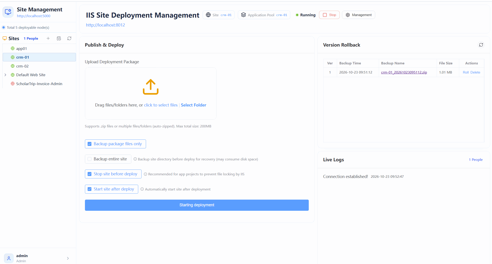
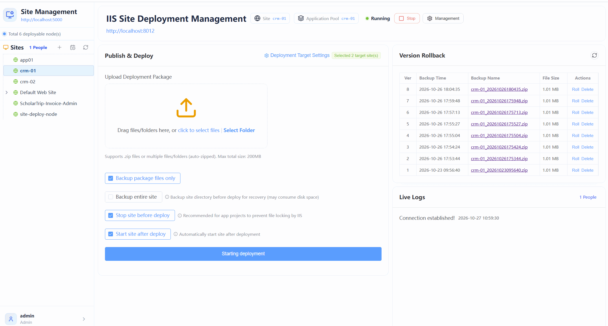
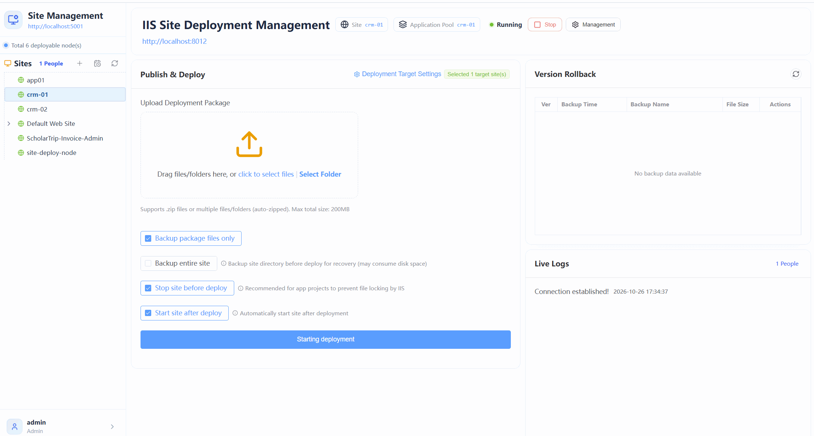

# 🚀 IIS Site Publishing Management System (SiteDeploy)

<p align="center">
  <a href="./README_ZH.md">简体中文</a> | <b>English</b>
</p>

> **Summary**: An efficient operations and maintenance tool supporting automated IIS site publishing, multi-server cluster unified deployment, one-click automatic backup, and version rollback.

---

## 📖 Table of Contents

- [✨ Features](#-features)
- [🛠️ Installation & Configuration](#️-installation--configuration)
  - [Single Server Deployment](#1-single-server-deployment-iis-mode)
  - [Multi-Server Deployment](#2-multi-server-deployment-iis-mode)
  - [Reverse Proxy Configuration](#3-reverse-proxy-configuration-high-security-environment)
- [💡 Usage Guide](#-usage-guide)
  - [System Login](#system-login)
  - [Permission Management](#permission-management)
  - [Use Cases](#use-cases)

---

## ✨ Features

- **🌍 Multi-language Support**: Natively supports switching between Simplified Chinese and English to seamlessly fit different teams.
- **📦 Core Publishing**: One-click packaging, uploading, overwriting, and restarting of IIS sites.
- **🌐 Multi-machine Coordination**: Supports unified management and distributed deployment for single-server or multi-server clusters.
- **🛡️ Security Guarantee**: Built-in automated backup and rapid version rollback mechanisms, allowing second-level rollback if publishing fails.



---

## 🛠️ Installation & Configuration

### 1. Single Server Deployment (IIS Mode)

1. **Download & Extract**: Download the master node installation package `SiteDeploy.zip` and extract it to `C:\inetpub\wwwroot\SiteDeploy`.
2. **Configure Application Pool**:
   - Name: `sitedeploy`
   - .NET CLR Version: `No Managed Code`
   - Managed Pipeline Mode: `Integrated`
   - Advanced Settings: Change **Identity** from `ApplicationPoolIdentity` to **`LocalSystem`**.
3. **Add Website**:
   - Site name: `SiteDeploy`
   - Application pool: Select `sitedeploy`
   - Physical path: `C:\inetpub\wwwroot\SiteDeploy`
   - Port number: Custom (e.g., `8080`)
4. **Access & Initialization**:
   - Access URL: `http://localhost:8080`
   - **Login Credentials**:
     - Username: `admin`
     - Initial Password: Check the `admin_initial_password.txt` file in the site root directory.
5. **Configuration File Description (`appsettings.json`)**:
   - `SystemConfig.Urls`: Configures the URL addresses of slave nodes.
   - `SystemConfig.IpWhitelist`: IP whitelist to restrict access.
   - `BindUrl`: The URL address bound to the current site (required if configured as a Windows service; can be ignored for IIS sites).
   - `BasePath`: The base path of the site.

---

### 2. Multi-Server Deployment (IIS Mode)

> **Prerequisite**: Please ensure that the master node has been successfully deployed and is running.

1. **Download & Extract**: Download the slave node installation package `SiteDeploy.Node.zip` and extract it to `C:\inetpub\wwwroot\SiteDeploy.Node`.
2. **Configure Application Pool**:
   - Name: `sitedeploy.node`
   - .NET CLR Version: `No Managed Code`
   - Managed Pipeline Mode: `Integrated`
   - Advanced Settings: Change **Identity** from `ApplicationPoolIdentity` to **`LocalSystem`**.
3. **Add Website**:
   - Site name: `SiteDeploy.Node`
   - Application pool: Select `sitedeploy.node`
   - Physical path: `C:\inetpub\wwwroot\SiteDeploy.Node`
   - Port number: Custom (e.g., `8081`)
4. **Verify Slave Node**:
   - Visit `http://localhost:8081`. If the page properly displays the current site's URL, the configuration is successful (slave nodes do not require login).
   - **Configuration File Description (`appsettings.json`)**:
     - `SystemConfig.IpWhitelist`: IP whitelist restrictions.
     - `BindUrl`: Binding address for Windows service mode (can be ignored for IIS mode).
     - `BasePath`: Site base path.
5. **Associate Master Node**:
   - In the master node's configuration file (`appsettings.json`), add the slave node URL to `SystemConfig.Urls` (e.g., `http://localhost:8081`).

---

### 3. Reverse Proxy Configuration (High-Security Environment)

> 💡 **Applicable Scenario**: In high-security environments where it is inconvenient to switch the application pool identity to `LocalSystem`, you can run it via a reverse proxy.

1. **Modify Configuration File (`appsettings.json`)**:
   - Set the reverse proxy address `BindUrl` (e.g., `http://127.0.0.1:5002`).
   - Set the site base path `BasePath` (e.g., `sitedeploy`).
2. **Install and Start Windows Service**:
   - Run the `install-service.bat` script in the root directory as an administrator.
   - Ensure the browser can successfully access `http://127.0.0.1:5002/sitedeploy`.
3. **Configure IIS Reverse Proxy**:
   - Ensure IIS has the reverse proxy modules installed (**URL Rewrite** + **Application Request Routing (ARR)**).
   - Create an empty directory: `C:\inetpub\wwwroot\SiteDeploy-Proxy`.
   - Add a new website in IIS, bind a port (e.g., `8080`), and point the physical path to the proxy directory created above.
   - Replace the site's `web.config` file content:
     ```xml
     <?xml version="1.0" encoding="UTF-8"?>
     <configuration>
       <system.webServer>
         <rewrite>
           <rules>
             <rule name="ReverseProxyInboundRule1" stopProcessing="true">
               <match url="(.*)" />
               <action type="Rewrite" url="[http://127.0.0.1:5002/sitedeploy/](http://127.0.0.1:5002/sitedeploy/){R:1}" />
             </rule>
           </rules>
         </rewrite>
       </system.webServer>
     </configuration>
     ```
4. **Access the System**: Visit `http://localhost:8080` in your browser to use the system.

---

## 💡 Usage Guide

### System Login
> ⚠️ **Note**: Login is handled uniformly on the master node; slave nodes do not provide a login interface.
- **Default Account**: `admin`
- **Default Password**: Found in the `admin_initial_password.txt` file located in the site root directory.

### Permission Management
- After logging in, the administrator can create sub-users and configure fine-grained permissions, specifying which servers and specific sites each user can operate.
- **Configuration Example**: Allowing `user1` to operate `http://localhost:5000` (crm-01, crm-02 sites) and `http://localhost:5001` (app01, crm-01, crm-02 sites).



### Use Cases

- **Single Site Publishing**:
  

- **Multi-Site Collaborative Publishing**:
  

- **Rapid Version Rollback/Restoration** (taking `http://localhost:5000` and `http://localhost:5001` as examples):
  